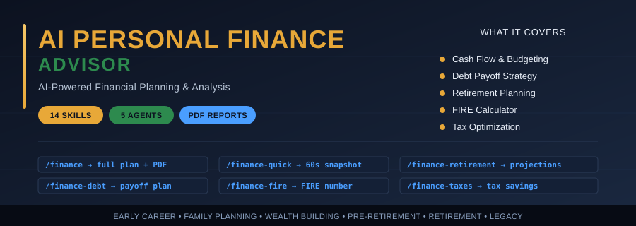

# AI Personal Finance Advisor for Claude Code

> **AI-Powered Financial Planning & Analysis Engine — 14 skills, 5 parallel agents, professional PDF reports.**

> ⚠️ **This is NOT financial advice.** This tool is for informational and educational purposes only. Consult a licensed financial advisor, CPA, or attorney before making any financial decisions.


---

## ⭐ Why This Exists

Traditional financial advisors charge **1% of assets under management** every year — that's **$10,000/year on a $1M portfolio** for advice that's often a slide deck and a phone call.

A junior CFP costs **$2,000–$5,000** for a one-time plan. A fee-only fiduciary costs **$200–$400/hour**.

This tool gives you the same multi-dimensional financial analysis — cash flow, debt strategy, investment allocation, retirement projections, tax optimization, FIRE planning, estate gaps — **as a professional PDF report**, generated in **under 5 minutes**, **for free**, right inside Claude Code.

It does not replace a fiduciary advisor for execution, but it gives you the **diagnosis** and **prioritized action plan** that you would otherwise pay thousands for.

---

## 🚀 What It Does

- 📊 **Financial Health Score (0–100)** — composite score across 5 dimensions, with letter grade and signal
- 💵 **Cash Flow Analysis** — income vs expense breakdown, savings rate, leverage points
- 💳 **Debt Payoff Strategy** — avalanche vs snowball comparison, payoff timeline, total interest cost
- 📈 **Investment Allocation Review** — current vs target allocation, drift detection, rebalance recommendations
- 🎯 **Retirement Projections** — current path vs target, gap analysis, multiple contribution scenarios
- 🔥 **FIRE Calculator** — Financial Independence number, years to FI, withdrawal-rate modeling
- 🧾 **Tax Optimization** — HSA, 401(k), Roth conversion, tax-loss harvesting opportunities
- 🛡️ **Protection Audit** — life, disability, umbrella, estate documents, emergency fund
- 📋 **Top 10 Action Items** — prioritized by impact, ready to execute
- 🗓️ **90-Day Plan** — month-by-month tasks (Foundation → Acceleration → Optimization)
- 📄 **Professional PDF Report** — 9-page client-ready deliverable with charts and tables

---

## 📦 Installation

**One-command install (recommended):**

```bash
curl -fsSL https://raw.githubusercontent.com/mohit626689/ai-finance-claude/main/install.sh | bash
```

**Local install:**

```bash
git clone https://github.com/mohit626689/ai-finance-claude.git
cd ai-finance-claude
./install.sh
```

**Uninstall:**

```bash
./uninstall.sh
```

The installer:
- Checks Python 3.8+ and auto-installs `reportlab>=4.0.0`
- Copies the orchestrator to `~/.claude/skills/finance/`
- Copies the 13 sub-skills to `~/.claude/skills/finance-*/`
- Copies agents to `~/.claude/agents/`
- Copies the PDF generator to `~/.claude/skills/finance/scripts/`

---

## ⚡ Command Reference

| Command | What It Does |
| --- | --- |
| `/finance` | **Main orchestrator** — full multi-agent plan + PDF report |
| `/finance-quick` | 60-second snapshot — score, signal, top 3 actions (no agents) |
| `/finance-analyze` | Full multi-agent analysis (5 parallel agents) |
| `/finance-budget` | Cash flow & monthly budget analysis with leverage points |
| `/finance-debt` | Debt payoff strategy — avalanche vs snowball, timeline, interest cost |
| `/finance-emergency` | Emergency fund target & build plan based on expenses |
| `/finance-portfolio` | Investment allocation review with drift & rebalance recs |
| `/finance-retirement` | Retirement projections with multiple contribution scenarios |
| `/finance-fire` | FIRE calculator — FI number, years to FI, withdrawal-rate stress test |
| `/finance-taxes` | Tax-saving opportunities (HSA, 401(k), Roth, tax-loss harvesting) |
| `/finance-networth` | Net worth tracker with assets/liabilities breakdown |
| `/finance-goals` | Goal-based planning (house, kids' college, sabbatical, etc.) |
| `/finance-compare` | Compare two scenarios side-by-side (rent vs buy, job offers, etc.) |
| `/finance-screen` | Financial product screener (HYSA, IRAs, brokerages, credit cards) |
| `/finance-report-pdf` | Generate the client-ready PDF from a saved analysis |

---

## 🤖 How It Works

When you run `/finance`, the orchestrator launches **5 parallel sub-agents** that each analyze one dimension of your finances:

1. **Cash Flow Agent** — income, expenses, savings rate, leverage opportunities
2. **Debt Agent** — payoff strategy, timeline modeling, interest minimization
3. **Investment Agent** — allocation analysis, drift detection, rebalance recommendations
4. **Retirement Agent** — gap analysis, contribution scenarios, projection modeling
5. **Protection Agent** — insurance audit, estate document review, emergency fund check

Each agent produces a scored sub-report (0–100). The orchestrator then **synthesizes** them into a single weighted **Financial Health Score**, plus a letter grade (A+ to F) and a plain-English signal (Excellent / Healthy / Fair / Weak / Critical).

The PDF generator (`generate_finance_pdf.py`, built on ReportLab) renders the final 9-page report with score gauges, horizontal bar charts, allocation pie chart, payoff timeline, and a prioritized action table.

```
┌─────────────────┐
│ /finance        │  ← user types in Claude Code
└────────┬────────┘
         │
   ┌─────▼─────┐
   │Orchestrator│
   └─────┬─────┘
         │ launches 5 in parallel
   ┌─────┼──────┬──────┬──────┬──────┐
   ▼     ▼      ▼      ▼      ▼      ▼
 Cash  Debt  Invest  Retire Protect
   │     │      │      │      │
   └─────┴──────┼──────┴──────┘
                ▼
         Composite Score
                ▼
            PDF Report
```

---

## 🎯 Use Cases

- 🏠 **Personal financial planning** — annual or quarterly check-up
- 🔥 **FIRE planning** — early retirement modeling and withdrawal-rate stress tests
- 👨‍👩‍👧 **Family financial review** — coordinated planning for couples and parents
- 🏖️ **Pre-retirement planning** — final 5–10 year glide-path optimization
- 💳 **Debt elimination strategy** — high-interest payoff with maximum interest savings
- 💼 **Career change financial analysis** — pre/post job-change cash flow modeling
- 🏡 **House buying decision** — affordability analysis, rent vs buy, mortgage scenarios
- 📊 **Side-hustle income planning** — what to do with the extra $1K–$5K/month
- 🎓 **College savings strategy** — 529s, custodial accounts, scholarship trade-offs

---

## 📊 Example Output

Running `/finance` produces a **9-page professional PDF** (`FINANCE-PLAN.pdf`):

| Page | Content |
| --- | --- |
| 1 | **Cover** — Financial Health Score gauge (0–100), grade, signal, executive summary |
| 2 | **Score Dashboard** — horizontal bar charts for the 5 categories with notes |
| 3 | **Cash Flow** — income/expense table, savings rate, % of income breakdown |
| 4 | **Debt Summary** — accounts table, payoff timeline visual, total interest cost |
| 5 | **Investments** — allocation pie chart, current vs target, variance flags |
| 6 | **Retirement** — current vs target gap, progress bar, scenario comparison table |
| 7 | **Protection** — color-coded scorecard for life, disability, estate, emergency fund |
| 8 | **Top 10 Actions** — prioritized table by impact (High/Med/Low) |
| 9 | **90-Day Plan** — Month 1 (Foundation) → Month 2 (Acceleration) → Month 3 (Optimization) |

Every page carries a footer disclaimer and page number. The cover uses a half-circle gauge that's **color-coded green/amber/red** based on score band.

**Try the demo:**

```bash
python3 ~/.claude/skills/finance/scripts/generate_finance_pdf.py --demo
# → FINANCE-PLAN-sample.pdf
```

---

## 🏗️ Project Structure

```
ai-finance-claude/
├── README.md
├── LICENSE
├── install.sh
├── uninstall.sh
├── requirements.txt
├── .gitignore
├── .github/
│   └── banner.svg
├── finance/                         # main orchestrator skill
│   └── SKILL.md
├── skills/                          # 13 sub-skills
│   ├── finance-quick/
│   ├── finance-analyze/
│   ├── finance-budget/
│   ├── finance-debt/
│   ├── finance-emergency/
│   ├── finance-portfolio/
│   ├── finance-retirement/
│   ├── finance-fire/
│   ├── finance-taxes/
│   ├── finance-networth/
│   ├── finance-goals/
│   ├── finance-compare/
│   ├── finance-screen/
│   └── finance-report-pdf/
├── agents/                          # parallel sub-agents
└── scripts/
    └── generate_finance_pdf.py      # ReportLab PDF generator
```

---

## 💼 Want to Sell This as a Service?

This tool is purpose-built so that anyone in our community can offer **professional financial planning services** as a side business or full agency — without needing a CFP license to do basic diagnostic and education work (always refer execution to licensed professionals).

**Pricing benchmarks community members are charging:**

| Deliverable | Typical Price |
| --- | --- |
| One-time Financial Health Report (PDF) | **$500 – $1,500** |
| Quarterly review + updated plan | **$1,000 – $2,000/quarter** |
| Annual financial check-up + accountability calls | **$2,000 – $5,000/year** |
| Couples financial planning package | **$1,500 – $3,000** |
| Pre-retirement glide-path package | **$2,000 – $4,000** |

**The math:** ten $1,000 reports per month = **$10,000/month in recurring service income**, delivered in minutes with this tool.

### 👉 Join the AI Workshop community to get:

- ✅ Step-by-step **client acquisition playbook** (cold outreach scripts, LinkedIn templates)
- ✅ **Pricing & packaging guides** for financial planning services
- ✅ **Compliance disclaimers** and engagement letter templates
- ✅ **Sales scripts** for the discovery call → paid engagement conversion
- ✅ **Done-for-you marketing assets** (landing pages, lead magnets, email sequences)
- ✅ Direct access to the creator and the community

### 🔗 [**Join the AI Workshop → skool.com/aiworkshop**](https://skool.com/aiworkshop)

---

## 🔗 Related Tools

Part of the **"Build and Sell with Claude Code"** series:

| Repo | What It Does |
| --- | --- |
| [ai-marketing-claude](https://github.com/mohit626689/ai-marketing-claude) | AI Marketing Suite — full marketing audits & content |
| [ai-sales-team-claude](https://github.com/mohit626689/ai-sales-team-claude) | AI Sales Team — prospect research, outreach, follow-ups |
| [ai-legal-claude](https://github.com/mohit626689/ai-legal-claude) | AI Legal Assistant — contract review, NDA, ToS, privacy |
| [ai-reputation-claude](https://github.com/mohit626689/ai-reputation-claude) | AI Reputation Manager — review response, crisis playbooks |
| [ai-ads-claude](https://github.com/mohit626689/ai-ads-claude) | AI Ads Strategist — full ad strategy, hooks, copy, funnels |
| [ai-trading-claude](https://github.com/mohit626689/ai-trading-claude) | AI Trading Analyst — stock analysis, options, sectors |
| [ai-crypto-claude](https://github.com/mohit626689/ai-crypto-claude) | AI Crypto Analyst — token analysis, DeFi, on-chain |
| [ai-realestate-claude](https://github.com/mohit626689/ai-realestate-claude) | AI Real Estate Analyst — property analysis, market, flip |
| [dataforseo-claude](https://github.com/mohit626689/dataforseo-claude) | DataForSEO toolkit — keyword research, rank tracking, backlinks |

---

## 📜 License

[MIT License](LICENSE) — © 2026 mohit626689. Free to use, modify, and resell as a service.

---

## ⚠️ Disclaimer

**This software is NOT financial advice.**

This tool is provided for informational and educational purposes only. The Financial Health Score, projections, recommendations, and any output generated by this software are based on inputs provided by the user and general financial principles, and should NOT be relied upon as a substitute for personalized advice from:

- A **licensed financial advisor** (CFP, CFA, fiduciary)
- A **Certified Public Accountant (CPA)** for tax matters
- An **attorney** for estate, legal, or contractual matters
- An **insurance professional** for coverage decisions

**Past performance does not guarantee future results.** Projections involve assumptions about market returns, inflation, and personal circumstances that may not match real-world outcomes.

The authors, contributors, and distributors of this software disclaim all liability for any financial decisions or outcomes that may result from use of this software. Use of this software constitutes acknowledgment of these limitations.

**If you are in financial distress, in default, facing foreclosure or bankruptcy, or making decisions involving significant sums of money, you should consult a licensed professional before acting on any output from this tool.**

---

*Built with [Claude Code](https://claude.com/claude-code) — Anthropic's official CLI for Claude.*
