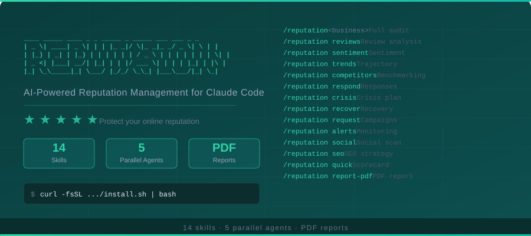

<p align="center">
  
</p>

<p align="center">
  <strong>AI Reputation Manager for Claude Code.</strong> Analyze online reviews, score brand sentiment, benchmark against competitors,<br/>
  generate review responses, create crisis playbooks, and produce PDF reputation reports — 14 skills, 5 parallel agents.
</p>

<p align="center">
  Your online reputation is your most valuable asset. This tool audits it in 60 seconds.
</p>

---

## Why This Matters

| Metric | Value |
|--------|-------|
| Consumers who read online reviews | 98% |
| Revenue increase per 1-star improvement | 5–9% |
| Businesses that never respond to reviews | 75% |
| Customers lost from a single bad review | 22% |
| Cost of professional reputation management | $1,000–$10,000/month |
| Time to audit with this tool | Under 60 seconds |

---

## Quick Start

```bash
curl -fsSL https://raw.githubusercontent.com/mohit626689/ai-reputation-claude/main/install.sh | bash
```

That's it. One command installs all 14 skills, 5 agents, and the PDF generation scripts.

---

## Manual Install

```bash
git clone https://github.com/mohit626689/ai-reputation-claude.git
cd ai-reputation-claude
chmod +x install.sh
./install.sh
```

---

## All 14 Commands

### Reputation Audit
| Command | What It Does |
|---------|-------------|
| `/reputation <business>` | **Flagship** — Full reputation audit with 5 parallel agents. Returns a Reputation Score (0-100), sentiment breakdown, competitor benchmarking, and prioritized action plan. |
| `/reputation reviews <business>` | Review analysis across Google, Yelp, Trustpilot, BBB, and other platforms. Categorizes themes and patterns. |
| `/reputation sentiment <business>` | Deep sentiment analysis with emotional breakdown — trust, frustration, satisfaction, loyalty. |
| `/reputation trends <business>` | Reputation trajectory analysis — tracks rating changes, review volume, and sentiment shifts over time. |
| `/reputation competitors <business>` | Benchmarks reputation against top 3-5 competitors. Compares ratings, review volume, sentiment, and response rates. |
| `/reputation quick <business>` | 60-second reputation scorecard — fast overview of brand health and key metrics. |

### Review Management
| Command | What It Does |
|---------|-------------|
| `/reputation respond <business>` | Generate professional, empathetic review responses for customer reviews. |
| `/reputation crisis <situation>` | Crisis response playbook generator — viral complaints, PR incidents, review bombing, and social media blowups. |
| `/reputation recover <review>` | Review recovery strategy — turn negative reviews into positive outcomes. |
| `/reputation request <business>` | Review request campaigns — generate templates and strategies to solicit more reviews. |

### Monitoring & Online Presence
| Command | What It Does |
|---------|-------------|
| `/reputation alerts <business>` | Monitoring setup guide — alert configuration for ongoing reputation tracking across all platforms. |
| `/reputation social <business>` | Social media reputation scan — analyze brand presence and sentiment across social platforms. |
| `/reputation seo <business>` | Reputation SEO strategy — optimize search results to highlight positive brand content. |
| `/reputation report-pdf` | Professional PDF reputation report with score gauges, sentiment charts, and prioritized actions. |

---

## The Flagship: `/reputation <business>`

The most powerful command. Run it on any business and get:

1. **Reputation Score** (0-100) with letter grade (A+ through F)
2. **Review Analysis** — ratings and themes across all platforms
3. **Sentiment Breakdown** — positive/negative/neutral ratios with emotional drivers
4. **Competitor Benchmarking** — side-by-side comparison with top competitors
5. **Response Assessment** — current response rate and quality evaluation
6. **Action Plan** — quick wins, 30-day improvements, and 90-day strategy
7. **Crisis Prevention** — proactive checklist to protect reputation
8. **Next Steps** — actionable checklist with priorities

### How It Works

```
/reputation Acme Corp
```

5 AI agents launch in parallel:

| Agent | Role | Weight |
|-------|------|--------|
| reputation-reviews | Collects and analyzes reviews across all platforms | 25% |
| reputation-sentiment | Calculates sentiment scores and emotional drivers | 20% |
| reputation-competitors | Compares reputation against top competitors | 20% |
| reputation-response | Generates optimal response strategies | 15% |
| reputation-recommendations | Produces prioritized improvement plan | 20% |

Results are aggregated into a unified report with a single Reputation Score.

---

## Command Reference

| Command | Description |
|---------|-------------|
| `/reputation <business>` | Full reputation audit (5 parallel agents) |
| `/reputation reviews <business>` | Review analysis across platforms |
| `/reputation sentiment <business>` | Deep sentiment analysis |
| `/reputation trends <business>` | Reputation trajectory analysis |
| `/reputation competitors <business>` | Competitor benchmarking |
| `/reputation respond <business>` | Generate review responses |
| `/reputation crisis <situation>` | Crisis response playbook |
| `/reputation recover <review>` | Review recovery strategy |
| `/reputation request <business>` | Review request campaigns |
| `/reputation alerts <business>` | Monitoring setup guide |
| `/reputation social <business>` | Social media reputation scan |
| `/reputation seo <business>` | Reputation SEO strategy |
| `/reputation quick <business>` | 60-second scorecard |
| `/reputation report-pdf` | Professional PDF report |

---

## Use Cases

### For Local Businesses
- Audit your online reputation across Google, Yelp, and industry platforms
- Identify what customers love and what needs fixing
- Generate professional responses to every review
- Benchmark against local competitors

### For Agencies & Consultants
- Offer reputation audits as a paid service ($500-$2,000 per audit)
- Generate professional PDF reports for clients
- Create ongoing monitoring and response retainers
- Scale review management across multiple clients

### For E-Commerce Brands
- Track product review sentiment across marketplaces
- Identify recurring product issues from review themes
- Generate responses to negative product reviews
- Monitor competitor product ratings

### For AI Automation Agencies
- Add reputation management to your service offering
- Pair with the AI Marketing Suite and AI Sales Team
- Deliver monthly reputation reports to clients
- Build reputation monitoring dashboards

---

## Project Structure

```
ai-reputation-claude/
├── reputation/
│   └── SKILL.md                         # Main orchestrator (command router)
├── skills/
│   ├── reputation-audit/SKILL.md        # Full reputation audit (5 agents)
│   ├── reputation-reviews/SKILL.md      # Review analysis across platforms
│   ├── reputation-sentiment/SKILL.md    # Deep sentiment analysis
│   ├── reputation-trends/SKILL.md       # Reputation trajectory analysis
│   ├── reputation-competitors/SKILL.md  # Competitor benchmarking
│   ├── reputation-respond/SKILL.md      # Generate review responses
│   ├── reputation-crisis/SKILL.md       # Crisis response playbook
│   ├── reputation-recover/SKILL.md      # Review recovery strategy
│   ├── reputation-request/SKILL.md      # Review request campaigns
│   ├── reputation-alerts/SKILL.md       # Monitoring setup guide
│   ├── reputation-social/SKILL.md       # Social media reputation scan
│   ├── reputation-seo/SKILL.md          # Reputation SEO strategy
│   ├── reputation-quick/SKILL.md        # 60-second scorecard
│   └── reputation-report-pdf/SKILL.md   # PDF report generator
├── agents/
│   ├── reputation-reviews.md            # Review analysis agent
│   ├── reputation-sentiment.md          # Sentiment scoring agent
│   ├── reputation-competitors.md        # Competitor benchmarking agent
│   ├── reputation-response.md           # Response strategy agent
│   └── reputation-recommendations.md    # Action recommendations agent
├── scripts/
│   └── generate_reputation_pdf.py       # PDF generation (ReportLab)
├── install.sh                           # One-line installer
├── uninstall.sh                         # Clean uninstaller
└── README.md
```

---

## Requirements

- **Claude Code** (with an active Anthropic API key)
- **Python 3.8+** (for PDF generation only)
- **reportlab** — `pip3 install reportlab` (for PDF generation only)

---

## Uninstall

```bash
curl -fsSL https://raw.githubusercontent.com/mohit626689/ai-reputation-claude/main/uninstall.sh | bash
```

Or run locally:

```bash
./uninstall.sh
```

---

## Disclaimer

This tool is for educational and informational purposes only. Reputation analysis is based on publicly available data which may be incomplete or outdated. Always verify findings independently. This is **not** a substitute for professional reputation management services.

---

<p align="center">
  <strong>Part of the Claude Code Skills Series</strong><br>
  <a href="https://github.com/mohit626689/ai-marketing-claude">AI Marketing Suite</a> ·
  <a href="https://github.com/mohit626689/ai-sales-team-claude">AI Sales Team</a> ·
  <a href="https://github.com/mohit626689/ai-legal-claude">AI Legal Assistant</a> ·
  <strong>AI Reputation Manager</strong>
</p>

<p align="center">
  <a href="https://www.skool.com/aiworkshop">Learn How to Sell Claude Code Services to Real Businesses</a>
</p>

<p align="center">
  <a href="https://opensource.org/licenses/MIT"></a>
</p>
